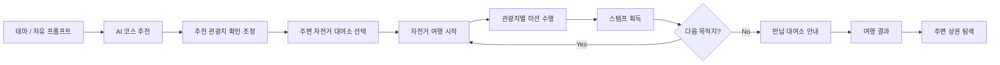
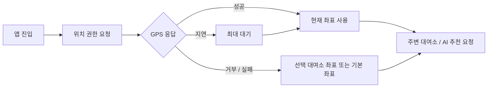
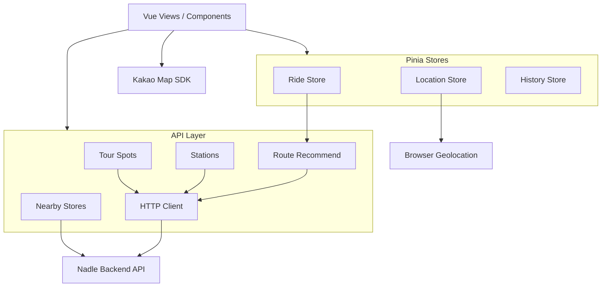
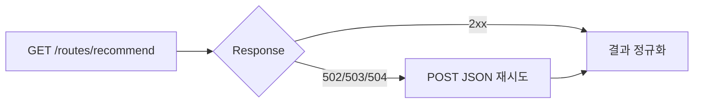

<div align="center">

# 🚲 Nadle

### AI가 여행 취향과 현재 위치를 이해하고, 자전거로 즐기는 동네 여행을 설계하는 미션형 모빌리티 서비스

**AI Route Recommendation · Public Bike Station · Kakao Map · Mission & Stamp · Local Discovery**


<br />

`2026 전국 통합데이터 활용 공모전` · `Mobile First Web` · `6-Step Riding Flow` · `Location Based Experience`

</div>

---

## Overview

**Nadle(나들)**은 사용자의 현재 위치와 원하는 여행 분위기를 바탕으로 AI가 자전거 여행 코스를 추천하고, 공공 자전거 대여소·관광지·미션·주변 상권을 하나의 여행 흐름으로 연결하는 모바일 웹 서비스입니다.

단순히 목적지까지 빠르게 이동하는 길찾기보다,

> **“오늘 동네에서 어디를, 어떤 방식으로 즐길 것인가?”**

에 집중했습니다.

사용자는 테마 또는 자연어 요청으로 여행을 시작하고, 추천 관광지를 확인한 뒤 주변 자전거 대여소에서 출발합니다. 주행 중 각 장소에서 미션을 수행해 스탬프를 모으고, 마지막에는 반납 대여소와 여행 결과, 주변에 더 들를 만한 장소까지 확인할 수 있습니다.

---

## Service Flow



실제 라우팅도 이 사용자 여정을 기준으로 **6개의 단계별 View**로 분리했습니다.

```text
/map/theme
   ↓
/map/preview
   ↓
/map/station
   ↓
/map/riding
   ↓
/map/return
   ↓
/map/result
```

---

## Core Experience

### 1. 🤖 자연어 기반 AI 코스 추천

사용자는 미리 준비된 테마를 선택하거나 원하는 여행 조건을 직접 입력할 수 있습니다.

예를 들어,

```text
벚꽃을 볼 수 있는 1시간짜리 코스 추천해줘
조용한 골목과 카페를 들르는 코스로 바꿔줘
```

처럼 입력하면 현재 위치 또는 선택한 대여소 좌표와 함께 추천 API로 전달합니다.

추천 결과가 마음에 들지 않는 경우 기존 테마와 추가 요청을 합쳐 **코스를 다시 조정하는 대화형 흐름**을 제공합니다.

---

### 2. 📍 GPS와 공공 자전거 대여소 연결

브라우저 Geolocation API로 현재 위치를 가져오고 주변 대여소를 조회합니다.

위치 정보는 앱 진입 즉시 항상 준비되는 값이 아니기 때문에, 단순히 `lat/lng` 존재 여부만 확인하지 않고 GPS 응답을 일정 시간 기다리는 `waitForCoords()` 흐름을 분리했습니다.



대여소 데이터는 화면이 API 원본 필드에 직접 의존하지 않도록 `stationId`, `stationName`, `parkingBikeTotCnt` 등의 응답을 프론트엔드 모델로 정규화합니다.

---

### 3. 🗺️ 지도 중심 모바일 경험

Kakao Map을 공통 지도 컴포넌트로 분리하고 화면에 따라 관광지, 대여소, 현재 위치, 주변 상권 등의 Marker를 조합합니다.

- AI 추천 관광지 지도 표시
- 주변 공공 자전거 대여소 Marker
- 대여소 / 관광지 상세 Bottom Sheet
- 라이딩 중 목적지 확인
- 여행 종료 후 방문 코스 지도
- 주변 상권 위치 표시

복잡한 지도 화면을 View 내부에 직접 구현하지 않고 `KakaoMap`, `MapPreviewSection`, 각 Detail Sheet로 역할을 나눴습니다.

---

### 4. 🎮 이동을 경험으로 바꾸는 미션 시스템

각 관광지는 단순 체크포인트가 아니라 미션을 수행하는 장소가 됩니다.

현재 프론트엔드에는 다음 미션 UI가 컴포넌트 단위로 분리되어 있습니다.

| Mission | Experience |
| --- | --- |
| 📷 Photo | 장소에서 사진 인증 경험 |
| ⭕❌ O/X Quiz | 관광지와 연결된 퀴즈 수행 |
| ⏱️ Rest | 여행 중 잠시 쉬어 가는 타이머 |

사용자가 도착을 확인하고 미션을 완료하면 현재 목적지 index를 이동시키고 스탬프를 라이딩 상태에 누적합니다.

---

### 5. 🏁 여행 종료 후에도 이어지는 경험

마지막 목적지를 완료하면 여행은 단순 종료되지 않습니다.

- 주변 반납 대여소 안내
- 획득한 스탬프 표시
- 총 거리 / 소요 시간 / 방문 코스 요약
- 전체 방문 경로 지도
- 마지막 위치 주변 상권 추천
- 음식점·카페 등 카테고리 필터 및 페이지네이션
- 과거 여행 기록 화면

즉, **추천 → 이동 → 체험 → 기록 → 지역 소비 탐색**까지 하나의 사용자 여정으로 구성했습니다.

---

## Frontend Architecture



### 상태의 책임 분리

| Store | Responsibility |
| --- | --- |
| `useRideStore` | 프롬프트, 선택 대여소, 추천 관광지, 현재 목적지, 스탬프, 라이딩 상태 |
| `useLocationStore` | GPS 요청 상태, 좌표, 권한 오류, 비동기 좌표 대기 |
| `useHistoryStore` | 완료된 여행과 누적 스탬프 |

페이지를 이동해도 여행 맥락이 유지되어야 하기 때문에 화면 컴포넌트가 아닌 **Pinia Store를 라이딩 세션의 단일 상태 중심점**으로 사용했습니다.

---

## Engineering Highlights

### 1. GPS 비동기성을 상태로 다뤘습니다

모바일 웹에서는 사용자가 위치 권한 팝업에 응답하는 시간과 GPS 좌표가 반환되는 시간이 일정하지 않습니다.

이를 단순 로딩 여부가 아니라

```text
idle → loading → ok
               ↘ denied
               ↘ unavailable
               ↘ error
```

상태로 관리하고, API 호출 전에 좌표가 준비될 때까지 기다리는 흐름을 별도로 구현했습니다.

---

### 2. AI API의 불안정한 요청 조건에 대응했습니다

추천 API는 기본적으로 GET query 방식으로 호출하지만, 긴 자연어 요구사항이나 인프라 상태에 따라 `502 / 503 / 504`가 발생할 수 있는 상황을 고려했습니다.



또한 백엔드 응답이 `spots`, `destinations`, `waypoints`, `route.spots` 등으로 달라질 수 있는 상황을 API 계층에서 흡수해 View가 응답 구조 변화에 직접 노출되지 않도록 했습니다.

---

### 3. 개발환경 CORS 문제를 Vite Proxy로 분리했습니다

로컬 프론트엔드에서 외부 백엔드로 직접 요청할 때 발생하는 CORS 문제를 개발 코드 곳곳에서 우회하지 않고 Vite 개발 서버의 `/api` Proxy로 통일했습니다.

```text
Development
Browser → /api/... → Vite Proxy → Backend

Production
Browser → VITE_API_BASE_URL → Backend
```

느린 외부 서버나 cold start 상황도 고려해 개발 Proxy timeout을 별도로 설정했습니다.

---

### 4. 외부 데이터는 화면 전에 정규화합니다

공공 데이터와 백엔드 응답은 동일한 의미의 값도 여러 이름으로 내려올 수 있습니다.

예를 들어 대여소의 자전거 수와 위치를 화면이 직접 해석하지 않고 API 계층에서 다음처럼 통일합니다.

```text
stationId / id
stationName / name
lat / latitude
lng / longitude / lon
parkingBikeTotCnt / availableBikes
rackTotCnt / totalSlots
                ↓
        Frontend Station Model
```

거리 정보가 없으면 Haversine 공식을 이용해 기준 좌표와 대여소 사이의 거리를 계산하고, API 장애 시 개발 흐름을 유지할 수 있도록 대여소 Mock fallback도 제공합니다.

---

### 5. 사용자 여정과 컴포넌트 구조를 맞췄습니다

Nadle은 하나의 거대한 지도 페이지가 아니라 **여행 상태가 단계적으로 변하는 서비스**입니다.

그래서 화면은 Journey 단계별 View로, 내부 기능은 도메인별 Component로 나눴습니다.

```text
Views
├─ Theme Setup
├─ AI Route Preview
├─ Station Select
├─ Active Riding
├─ Return Guide
└─ Result

Components
├─ ai/
├─ map/
├─ mission/
└─ ui/
```

라우트 단위 코드 스플리팅을 위해 Vue Router의 dynamic import를 사용하고 있습니다.

---

## Tech Stack

| Area | Technology |
| --- | --- |
| Framework | Vue 3 |
| Build Tool | Vite 8 |
| State | Pinia 2 |
| Routing | Vue Router 4 |
| Styling | Tailwind CSS 3, PostCSS |
| Map | Kakao Maps JavaScript SDK |
| Location | Browser Geolocation API |
| Icons | Lucide Vue Next, Twemoji |
| HTTP | Fetch API + custom API client |
| Image Tooling | Sharp |
| Deployment Config | Vercel SPA Rewrite |

---

## API Integration

| Domain | Endpoint / Role |
| --- | --- |
| AI Route | `/api/v1/routes/recommend` |
| Bike Station | `/api/v1/stations/nearby`, `/api/v1/stations/{id}` |
| Tourism Spot | 주변 관광지 및 상세 데이터 변환 |
| Local Store | `/api/v1/stores/nearby` |

프론트엔드는 각 도메인 API를 `src/api`에서 분리하고, 화면에 전달하기 전에 응답 파싱·오류 처리·필드 정규화를 수행합니다.

---

## Project Structure

```text
src/
├─ api/
│  ├─ client.js             # 공통 fetch client / API base URL
│  ├─ routes.js             # AI 코스 추천
│  ├─ stations.js           # 대여소 조회·상세·응답 정규화
│  ├─ spots.js              # 관광지 조회·모델 변환
│  └─ stores.js             # 주변 상권 조회
│
├─ components/
│  ├─ ai/                   # 테마 카드, AI 채팅 입력
│  ├─ map/                  # KakaoMap, Marker, 상세 Sheet
│  ├─ mission/              # 사진, O/X, 휴식 미션
│  └─ ui/                   # 공통 UI
│
├─ layouts/                 # 상단 Logo / 하단 Tab Navigation
│
├─ router/                  # 6단계 Journey Routing
│
├─ stores/
│  ├─ useRideStore.js       # 라이딩 세션
│  ├─ useLocationStore.js   # 위치/GPS 상태
│  └─ useHistoryStore.js    # 여행 기록
│
├─ utils/                   # 거리 계산 등 공통 유틸
│
└─ views/
   ├─ MapTab/
   │  ├─ 1_ThemeSetupView.vue
   │  ├─ 2_AiRoutePreviewView.vue
   │  ├─ 3_StationSelectView.vue
   │  ├─ 4_ActiveRidingView.vue
   │  ├─ 5_ReturnGuideView.vue
   │  └─ 6_ResultView.vue
   └─ HistoryTab/
```

---

## Getting Started

### Requirements

- Node.js
- npm
- Kakao Maps JavaScript App Key
- Nadle Backend API

### Installation

```bash
git clone https://github.com/Dev-SangWoo/Nadle-Front.git
cd Nadle-Front
npm install
```

환경 변수 파일을 생성합니다.

```bash
cp .env.example .env
```

```env
VITE_KAKAO_MAP_APP_KEY=YOUR_KAKAO_JAVASCRIPT_KEY
VITE_API_BASE_URL=YOUR_BACKEND_BASE_URL
```

개발 서버 실행:

```bash
npm run dev
```

프로덕션 빌드:

```bash
npm run build
```

---

## Current Scope

Nadle은 공모전 MVP를 목표로 핵심 여행 흐름을 우선 구현했습니다.

현재 구현 상태를 명확히 구분하면 다음과 같습니다.

### Implemented

- 테마 / 자연어 기반 AI 경로 요청
- AI 추천 결과 재조정
- 브라우저 GPS 위치 처리
- 주변 공공 자전거 대여소 조회 및 상세 UI
- Kakao Map 기반 지도 경험
- 6단계 라이딩 Journey
- 미션 UI 및 스탬프 진행 상태
- 반납 대여소 안내
- 여행 결과 지도와 요약
- 주변 상권 추천·필터·페이지네이션
- 여행 기록 화면

### Prototype / Next Step

- 사진 미션의 실제 이미지 인증
- 여행 기록의 서버 영속화
- 실제 주행 거리·시간 GPS Tracking
- 미션 완료 조건의 위치 기반 자동 검증
- 추천 실패 전략과 사용자 재시도 UX 고도화
- 테스트 자동화 및 CI 구축

---

## Project Goal

Nadle이 해결하려는 문제는 단순히 **“자전거 길을 추천하는 것”**이 아닙니다.

공공 자전거와 지역 데이터를 활용해 이동 자체를 하나의 작은 여행으로 만들고,

```text
공공 자전거 이용
      +
지역 관광지 발견
      +
게임형 미션 경험
      +
주변 상권 연결
```

이라는 흐름으로 사용자가 익숙한 동네를 다시 발견하도록 만드는 것이 목표입니다.
